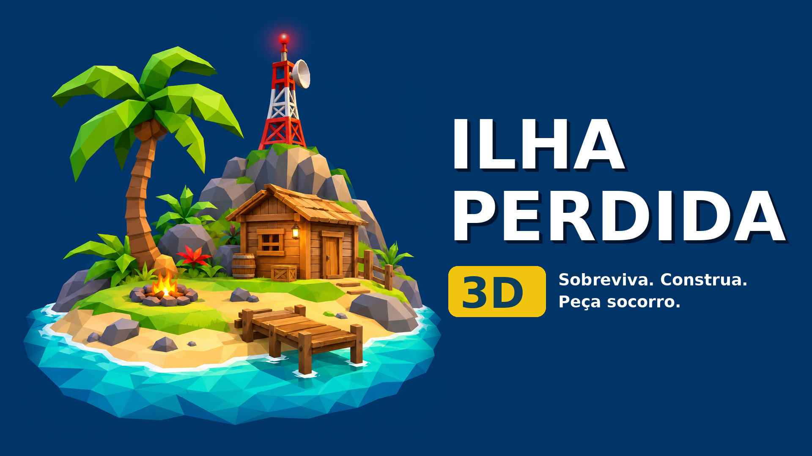

# 🏝️ Ilha Perdida 3D



Jogo 3D de exploração, sobrevivência e construção que roda direto no navegador (Three.js). Você acorda numa ilha após um acidente: colete recursos, construa um abrigo, derrote o chefe da caverna, ache as peças do rádio e peça socorro.

## Controles
| PC | Ação |
|---|---|
| WASD / Shift / Espaço | andar / correr / pular |
| Mouse | olhar (clique na tela para capturar; ESC solta) |
| Botão esquerdo (segurar) | quebrar o que está na mira / atacar |
| E | interagir (rádio, baú, dormir) |
| I / F / V / ESC | mochila / comer / câmera 1ª-3ª pessoa / pausa |

No celular: joystick à esquerda, arraste para olhar, botões de pulo, E (segure para quebrar), 🎒, 👁 e ⏸.

## Rodar localmente
```
python -m http.server
```
Abra `http://localhost:8000` no Chrome (precisa de internet no primeiro acesso, para baixar o Three.js r128; depois funciona offline).

## Publicar no GitHub Pages
1. Suba o conteúdo desta pasta para um repositório.
2. Settings → Pages → Branch `main` / `(root)` → Save.
3. Acesse `https://SEU-USUARIO.github.io/NOME-DO-REPOSITORIO/`.

## Funcionalidades
Mundo 3D low poly (praia, floresta, montanhas, caverna, naufrágio), personagem em 1ª/3ª pessoa, coleta estilo Minecraft, mochila e fabricação, construção, sobrevivência (vida, fome, energia, dia/noite), monstros, chefe, 7 missões, final, salvamento automático, menu de pausa, qualidade gráfica, sons por código e PWA offline.

## Limitações conhecidas
- Ainda não testado em navegador real por quem programou: use o roteiro em `TESTES.md`.
- Sem música (só efeitos e som de ondas); caverna e chefe simples.
- O Three.js vem de um CDN no primeiro acesso (depois fica em cache).
- A qualidade gráfica muda nitidez e distância de visão, não a quantidade de objetos.
